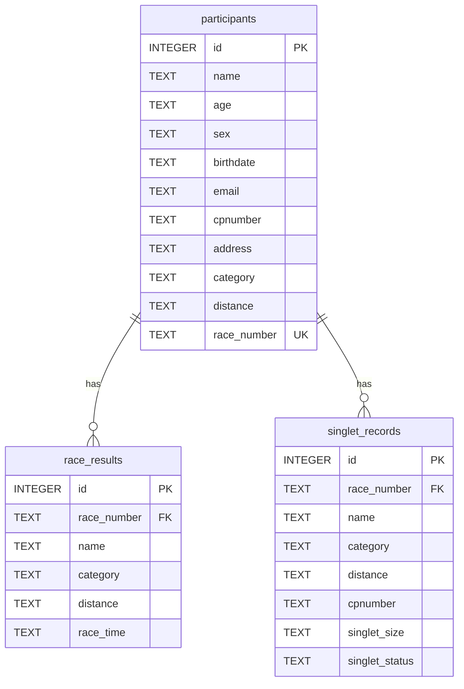
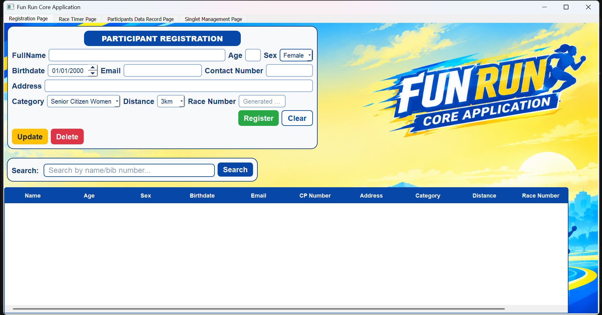
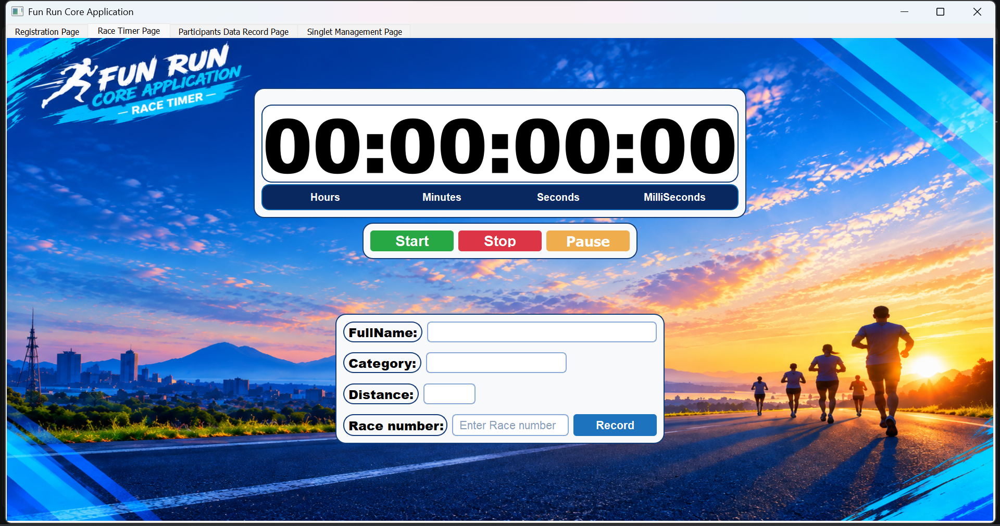
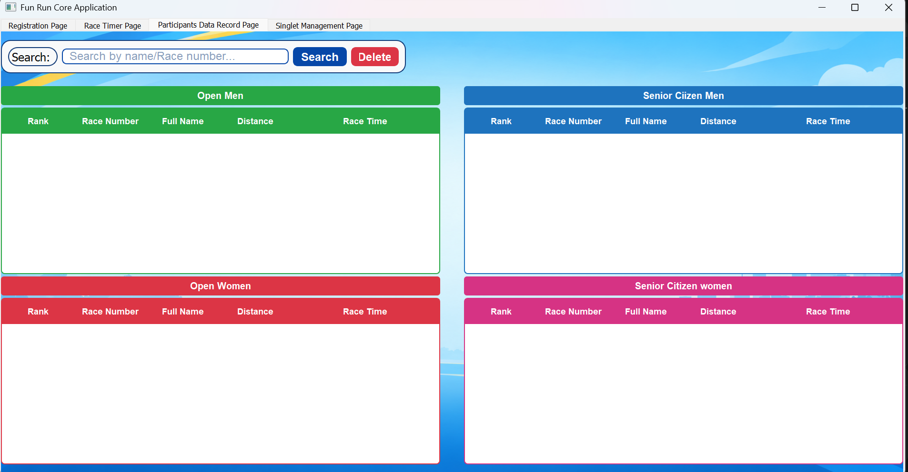
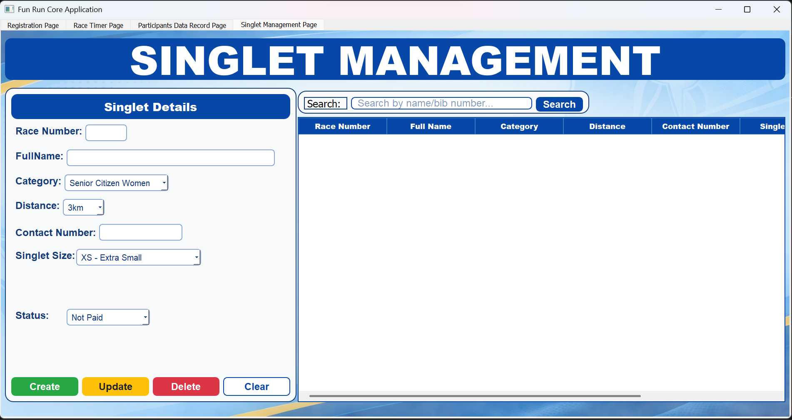

## Project Title

# FUN RUN CORE APPLICATION SYSTEM

**A Desktop Application for Managing Fun Run Participants, Race Results, and Singlet Records Using PyQt5 and SQLite**

## Project Description

The Fun Run Core Application System is a desktop application that I created to help organizers manage a fun run event.

The main purpose of this system is to replace the paper-based process of writing and recording participant information, race results, and singlet information.

When information is written on paper, it can be difficult to manage many participants. Records can also be lost, damaged, or hard to find when a participant has a question or complaint.

This application keeps participant information and race records in one database. It helps the organizer check participant information, race numbers, race results, categories, distances, and singlet information. The records can also be used as a reference if a participant has a complaint or needs to verify their information or race result.

Although more advanced systems exist, this project is designed to help small communities or barangays that organize fun run events. The goal is to make the process more organized and easier for the organizer to manage.

## Project Objectives

- Replace the paper-based process of recording participants and race information.
- Make participant records more organized and easier to manage.
- Make it easier for organizers to search and check participant information.
- Record and manage race results using a database.
- Provide records that can be used as a reference when participants have questions or complaints.
- Manage singlet information, including singlet size and singlet status.
- Help small communities or barangays organize fun run events more easily.
- Reduce the difficulty of managing many records manually.

## Features

### 1. Participant Registration

- **Create** – Add and save new participant information, including name, age, sex, birthdate, email, contact number, address, category, distance, and race number.
- **Read** – View saved participant information.
- **Update** – Modify existing participant information.
- **Delete** – Remove a participant record.
- **Search** – Find participant information using the search function.

### 2. Race Timer

- **Search** – Find a participant using their race number.
- **Retrieve** – Display the participant's name, category, and distance from the participant records.
- **Start / Pause / Stop** – Control the race timer.
- **Record** – Save the participant's race time in the database.
- **Validation** – Check the race number, verify that the participant exists, and prevent duplicate race records.

The race timer displays hours, minutes, seconds, and milliseconds.

### 3. Participants Data Record

- **Read** – Display race results in the category tables.
- **Search** – Find a specific race record.
- **Rank** – Display participant rankings based on race results.
- **Delete** – Remove a selected race record.
- **Category Management** – Organize race results into four categories:
  - Open Men
  - Open Women
  - Senior Citizen Men
  - Senior Citizen Women

Each category table displays rank, race number, full name, distance, and race time.

### 4. Singlet Management

- **Create / Read / Update / Delete** – Manage singlet records.
- **Search** – Find singlet information using the search function.
- **Singlet Size Management** – Select and manage the participant's singlet size.
- **Singlet Status Management** – Set and update the participant's singlet status.

### 5. Database Storage

All participant, race result, and singlet records are stored in the `FunRun.db` SQLite database. See the [Database](#database) section for details.

## Technologies Used

- **Programming Language:** Python 3.14
- **GUI Framework/Library:** PyQt5 (including `uic` for loading `.ui` files)
- **Database:** SQLite (through Python's built-in `sqlite3` library)
- **UI Design Tool:** Qt Designer
- **Code Editor:** Visual Studio Code
- **Operating System:** Windows

## Project Structure

```text
Fun_Run_Core_Application/
│
├── background/
│   ├── FirstBackground.png
│   ├── FourthBackground.png
│   ├── SecondBackground.png
│   └── ThirdBackground.png
│
├── database/
│   └── database.py
│
├── features/
│   ├── participantsDataRecordFrontPage/
│   │   ├── participantsDataRecordPage.py
│   │   └── participantsDataRecordUi.ui
│   │
│   ├── raceTimerFrontPage/
│   │   ├── raceTimerPage.py
│   │   └── raceTimerUi.ui
│   │
│   ├── registrationFrontPage/
│   │   ├── model.py
│   │   ├── registrationBg.ui
│   │   ├── registrationPage.py
│   │   ├── repository.py
│   │   └── service.py
│   │
│   └── singletManagementFrontPage/
│       ├── singletManagement.ui
│       └── singletManagementPage.py
│
├── Screenshots/
│   ├── registration_page.png
│   ├── race_timer_page.png
│   ├── participants_data_record_page.png
│   └── singlet_management_page.png
│
├── main_window.py
├── main.py
├── FunRun.db
├── .gitignore
└── README.md
```

> The virtual environment folder (`myappvenv/`) is created locally during setup and is excluded from Git through `.gitignore`.

## Purpose of the Major Folders and Files

| Folder / File | Purpose |
|---|---|
| `background/` | Background images used by the different pages. |
| `database/database.py` | Creates and manages the database connection and tables. |
| `features/` | Contains the different pages (features) of the application. |
| `registrationPage.py` | Handles the registration page and user actions. |
| `model.py` | Defines the participant data structure. |
| `repository.py` | Handles database operations for participant records. |
| `service.py` | Handles participant-related validation and business logic. |
| `raceTimerPage.py` | Handles the race timer and recording of race results. |
| `participantsDataRecordPage.py` | Handles the display and management of race results. |
| `singletManagementPage.py` | Handles singlet record management. |
| `*.ui` files | Interface designs created in Qt Designer. |
| `Screenshots/` | Screenshots used in this README. |
| `main_window.py` | Creates the main window and connects the different pages. |
| `main.py` | Starts the application. |
| `FunRun.db` | SQLite database file for all system records. |
| `.gitignore` | Lists files and folders that should not be included in Git. |
| `README.md` | Project documentation. |

## Installation and Setup

### Requirements

- Python 3.14
- PyQt5
- Visual Studio Code
- Windows operating system

### Setup Steps

1. Download or clone the project from the GitHub repository.
2. Open the `Fun_Run_Core_Application` folder in Visual Studio Code.
3. Open the terminal in Visual Studio Code.
4. Create a virtual environment:

```bash
   python -m venv myappvenv
```

5. Activate the virtual environment:

```powershell
   .\myappvenv\Scripts\Activate.ps1
```

   If you are using Command Prompt instead of PowerShell, use:

```bat
   myappvenv\Scripts\activate.bat
```

6. Install PyQt5:

```bash
   python -m pip install PyQt5
```

7. Run the application:

```bash
   python main.py
```

## How to Use the System

### 1. Registration Page

1. Open the Registration Page.
2. Enter the participant's information.
3. Click **Register** to save the participant.
4. Use **Search** to find a participant.
5. Use **Update** to change participant information.
6. Use **Delete** to remove a participant.
7. Use **Clear** to empty the input fields.

### 2. Race Timer Page

1. Open the Race Timer Page.
2. Enter the participant's race number.
3. The participant's name, category, and distance are retrieved from the participant records.
4. Click **Start** to begin the timer.
5. Use **Pause** or **Stop** when needed.
6. Click **Record** to save the race result.

Before saving, the system checks that the race number is entered correctly, verifies that the participant exists, and checks for an existing race result to prevent duplicate records.

### 3. Participants Data Record Page

The page contains four category tables: Open Men, Open Women, Senior Citizen Men, and Senior Citizen Women. Each table displays the participant's rank, race number, full name, distance, and race time.

Available operations:

- View recorded race results.
- Search for a race record.
- Review participant rankings and recorded race times.
- Delete a selected race record when needed.

### 4. Singlet Management Page

1. Open the Singlet Management Page.
2. Enter the participant's information.
3. Select the singlet size.
4. Select or set the singlet status.
5. Create and update singlet records using the available buttons.

## OOP Implementation

The project uses Object-Oriented Programming (OOP) to organize the system into classes and objects.

### Important Classes

| Class | Responsibility |
|---|---|
| `Participant` | Represents participant information (name, age, sex, birthdate, email, contact number, address, category, distance, race number). |
| `ParticipantService` | Handles participant-related rules and validation. |
| `ParticipantRepository` | Handles database operations for participant records. |
| `Database` | Handles the SQLite connection and database operations. |
| `RegistrationPage` | Handles the participant registration interface. |
| `RaceTimerPage` | Handles the race timer and recording of race results. |
| `ParticipantsDataRecordPage` | Handles viewing and managing race results. |
| `SingletManagementPage` | Handles singlet records. |
| `MainWindow` | Creates the main window and connects the different pages. |

### Encapsulation

Data and related functions are placed inside classes. For example, `Participant` holds participant data, `ParticipantService` handles participant rules, and `ParticipantRepository` handles database access. Each class has its own responsibility.

### Inheritance

The page classes inherit from the PyQt5 `QMainWindow` class: `RegistrationPage`, `RaceTimerPage`, `ParticipantsDataRecordPage`, `SingletManagementPage`, and `MainWindow`. This lets them reuse the window behavior provided by `QMainWindow`.

### Polymorphism

Because all page classes inherit from `QMainWindow`, they share the same interface (for example, `show()` and `close()`), so `MainWindow` can open and control any page in the same way. Each page then provides its own behavior and interface for its specific task.

## Database

The project uses **SQLite**. All records are stored in the `FunRun.db` file, which contains three main tables.

### `participants`

Stores the main participant information.

| Field | Description |
|---|---|
| `id` | Unique ID of the participant. |
| `name` | Participant's full name. |
| `age` | Participant's age. |
| `sex` | Participant's sex. |
| `birthdate` | Participant's birthdate. |
| `email` | Participant's email address. |
| `cpnumber` | Participant's contact number. |
| `address` | Participant's address. |
| `category` | Participant's race category. |
| `distance` | Selected race distance. |
| `race_number` | Participant's unique race number. |

### `race_results`

Stores the race results.

| Field | Description |
|---|---|
| `id` | Unique ID of the race result. |
| `race_number` | Participant's race number. |
| `name` | Participant's name. |
| `category` | Participant's category. |
| `distance` | Race distance. |
| `race_time` | Recorded race time. |

### `singlet_records`

Stores the participant's singlet information.

| Field | Description |
|---|---|
| `id` | Unique ID of the singlet record. |
| `race_number` | Participant's race number. |
| `name` | Participant's name. |
| `category` | Participant's category. |
| `distance` | Race distance. |
| `cpnumber` | Participant's contact number. |
| `singlet_size` | Selected singlet size. |
| `singlet_status` | Status of the singlet. |

### Entity Relationship Diagram (ERD)

The diagram shows the intended logical relationships between the tables.



> This ERD represents the intended logical relationships. Actual relationship enforcement depends on the constraints and settings in the SQLite database.

### Database Operations

The system performs these operations through its functions:

- **Create** – Add new participant, race result, and singlet records.
- **Read** – Retrieve participant, race result, and singlet records.
- **Update** – Change existing information.
- **Delete** – Remove selected records.
- **Search** – Find specific participant, race result, and singlet records.

## Screenshots

### Registration Page

This page is used to register participants and manage their information.



### Race Timer Page

This page is used to record the race time of a participant. The organizer enters the race number, and the participant's information is displayed automatically.



### Participants Data Record Page

This page displays race results organized into four participant categories.



### Singlet Management Page

This page is used to manage singlet information, including singlet size and singlet status.



## Testing

| No. | Feature | Expected Result | Actual Result | Status |
|---:|---|---|---|---|
| 1 | Participant Registration | Participant information is saved. | Participant information was saved successfully. | Passed |
| 2 | Participant Search | The correct participant is displayed. | The correct participant was displayed. | Passed |
| 3 | Participant Update | Participant information is updated. | Participant information was updated successfully. | Passed |
| 4 | Participant Delete | The selected participant is deleted. | The selected participant was deleted. | Passed |
| 5 | Race Timer | The timer starts, pauses, and stops correctly. | The timer started, paused, and stopped correctly. | Passed |
| 6 | Race Result | The race result is saved in the database. | The race result was saved in the database. | Passed |
| 7 | Race Result Search | The correct race result is displayed. | The correct race result was displayed. | Passed |
| 8 | Race Result Delete | The selected race record is deleted. | The selected race record was deleted. | Passed |
| 9 | Singlet Management | Singlet size and singlet status are managed. | Singlet size and status were managed successfully. | Passed |
| 10 | Database Operations | Records are stored and retrieved correctly. | Records were stored and retrieved correctly. | Passed |

## System Testing Results

All main features were tested, and all 10 test cases passed. The tests covered participant registration, search, update and delete, race timing, race result management, singlet management, and database operations. The system worked as expected in all tested features.

## Known Issues / Limitations

- The system is designed as a desktop application only.
- Python, PyQt5, and the setup steps are required before it can run.
- There is no login or user account feature.
- The race timer depends on the race number being entered correctly.
- The system is designed for small fun run events and may need improvements for larger events.
- There is no automatic backup or online database feature yet.

## Author

- **Name:** Morly Boy G. Ylanan
- **Section:** CS26L(3581)